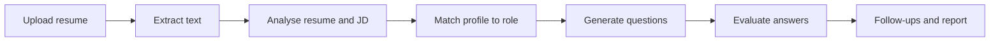

<div align="center">

# 🚀 AI Interview Accelerator

**From resume analysis to interview readiness, powered by AI.**

Upload your resume, paste a job description, and practise with role-specific questions, AI feedback on your answers, and adaptive follow-ups.


[](https://ai-interview-accelerator-delta.vercel.app/)

</div>

---

## 📌 Overview

Most interview prep tools hand you a generic list of questions. **AI Interview Accelerator** starts from *your* resume and the *specific role* you are applying for, so practice is relevant, structured and actionable.

**The problem:** knowing common interview questions is not the same as knowing how to answer them for a particular job.

**The approach:** analyse the resume and job description, find the gaps, generate targeted questions, evaluate your answers with an LLM, and ask deeper follow-ups based on what you say.

## 🌐 Live Demo

**👉 [ai-interview-accelerator-delta.vercel.app](https://ai-interview-accelerator-delta.vercel.app/)**

<!-- Add screenshots here when available:

-->

## ✨ Features

| | Feature | What it does |
|---|---|---|
| 📄 | **Resume upload and parsing** | Accepts PDF, DOCX and TXT, extracts text, and validates the file and its content |
| 🎯 | **Job description analysis** | Pulls out required skills, technologies and competencies from a JD |
| 📊 | **Job fit analysis** | Compares your profile with the role and highlights matches and skill gaps |
| 🤖 | **Interview generation** | Creates technical, behavioural and project-based questions tailored to you and the role |
| 🧠 | **Answer evaluation** | Scores answers with an LLM and explains what to improve |
| 🔄 | **Adaptive follow-ups** | Asks deeper questions based on your previous answers |
| 📈 | **Readiness report** | Summarises performance and what to practise next |

> **Note:** Features are marked complete only after their end-to-end workflow has been verified. See the [Roadmap](#-roadmap) for what is still in progress.

## 🛠️ Tech Stack

| Technology | Purpose |
|---|---|
| **Next.js (App Router)** | Framework, routing and API routes |
| **TypeScript** | Type safety and maintainability |
| **React** | Component-based UI |
| **Tailwind CSS** | Styling and responsive layouts |
| **Groq API** | LLM-powered analysis, generation and evaluation |
| **Zod** | Schema validation for requests and LLM output |
| **pdf-parse** | PDF text extraction |
| **Mammoth** | DOCX text extraction |

## 🧠 How It Works



1. **Upload:** provide your resume (PDF, DOCX or TXT).
2. **Extract:** readable text is pulled from the document.
3. **Analyse:** the resume and job description are processed for skills and requirements.
4. **Match:** your profile is compared with the target role.
5. **Generate:** role-specific interview questions are created.
6. **Evaluate:** your answers are assessed and feedback is returned.
7. **Improve:** follow-up questions and the readiness report guide further practice.

## 🔌 API Overview

| Endpoint | Responsibility |
|---|---|
| `POST /api/parse-file` | Parse an uploaded document and return its text |
| `POST /api/analyze-resume` | Analyse extracted resume information |
| `POST /api/analyze-jd` | Analyse job description requirements |
| `POST /api/generate-interview` | Generate interview questions |
| `POST /api/evaluate-answer` | Evaluate a candidate's response |

## 🏗️ Project Structure

```text
ai-interview-accelerator/
├── app/
│   ├── api/
│   │   ├── analyze-jd/
│   │   ├── analyze-resume/
│   │   ├── evaluate-answer/
│   │   ├── generate-interview/
│   │   └── parse-file/
│   ├── analysis/        # Fit analysis page
│   ├── interview/       # Mock interview page
│   ├── report/          # Readiness report page
│   ├── layout.tsx
│   └── page.tsx         # Landing / upload
├── components/
│   ├── analysis/
│   ├── interview/
│   ├── report/
│   ├── ui/
│   └── upload/
├── lib/                 # Shared helpers, schemas, LLM client
├── public/
├── .env.example
└── package.json
```

_Simplified view; some files are omitted._

## ⚙️ Getting Started

### Prerequisites

- Node.js 18.18+ (or the version your Next.js release requires)
- npm, pnpm, Yarn or Bun
- A [Groq API key](https://console.groq.com/)

### Installation

```bash
# 1. Clone the repository
git clone https://github.com/theayushgupta21/ai-interview-accelerator.git
cd ai-interview-accelerator

# 2. Install dependencies
npm install

# 3. Set up environment variables
cp .env.example .env.local
```

Add your key to `.env.local`:

```env
GROQ_API_KEY=your_groq_api_key
```

```bash
# 4. Start the dev server
npm run dev
```

Open [http://localhost:3000](http://localhost:3000).

### Production build

```bash
npm run build
npm run start
```

> 🔒 Never commit `.env.local` or real API keys. Keep `.env.example` limited to placeholder values.

## 🔐 Security and Reliability

- Validate uploaded file types and sizes.
- Handle malformed documents and empty extracted text safely.
- Validate LLM responses with Zod before using them.
- Handle rate limits, timeouts and API failures gracefully.
- Keep API keys on the server only.
- Avoid logging sensitive resume content.
- Treat AI scores and feedback as guidance, not a prediction of interview success.

## 🔮 Roadmap

- [ ] Voice-based mock interviews (speech recognition and text-to-speech)
- [ ] Adaptive interview difficulty
- [ ] Detailed interview readiness reports
- [ ] Progress tracking across sessions
- [ ] Better evaluation rubrics and answer explanations
- [ ] Stronger error handling and rate-limit management
- [ ] Automated tests for parsing, analysis and evaluation

## 🤝 Contributing

Issues and pull requests are welcome. For larger changes, please open an issue first to discuss what you would like to change.

## 👨‍💻 Author

**Ayush Gupta** | Full-Stack Developer

[](https://github.com/theayushgupta21)
[](https://www.linkedin.com/in/theayushgupta21/)

## 📄 License

Released under the MIT License. Add a `LICENSE` file to the repository root before distributing.